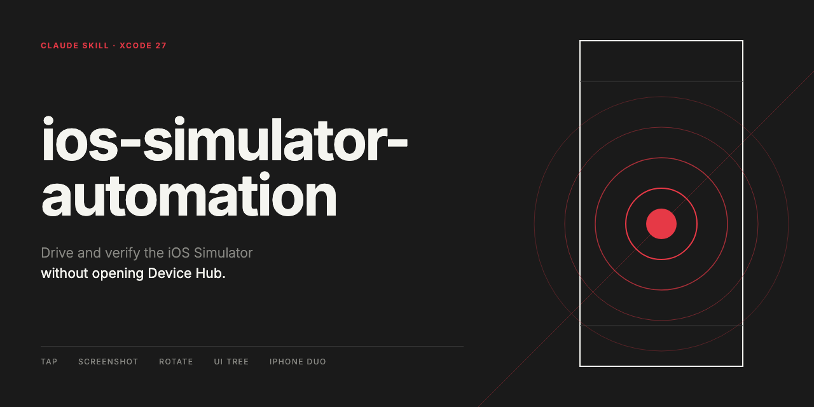

# ios-simulator-automation



**English** | [日本語](#日本語)

A Claude skill for driving and verifying the iOS Simulator from the command line and MCP.

Several tools can drive the simulator, and **among tools that nominally do the same thing, some work and some do not**. Worse, several of them return success while nothing actually happens. This skill sorts out which one to reach for.

At its center is the idea of **keeping track of why a tool was chosen**. If you cannot tell whether you are avoiding something because it is broken or because the other path is the proper one, you have no way to revisit the choice once the layer underneath is fixed. A guide that only lists the steps goes stale at that point.

The other axis is **whether the path goes through Device Hub**. Device Hub takes over the screen and stops your work, so if there is a direct route, use it. Conversely, two operations can only be done in Device Hub, and those have to be handed to a human. Knowing that boundary up front saves rework.

## What you can do with it

With this skill installed, Claude can carry out the following **without opening Device Hub**:

| What you want to do | What it uses |
|---|---|
| Tap (portrait) | `tap` in Claude's simulator panel |
| Tap (landscape) | `axe touch -x -y --down --up` |
| Read element coordinates and labels | `axe describe-ui` |
| Take a screenshot | `xcrun simctl io <UDID> screenshot` |
| Rotate the device | `xcrun devicectl device orientation set` |
| Rotate, tap and dump the hierarchy in one call | Xcode MCP's `DeviceInteractionSynthesize` |
| Dark mode, text size, contrast | `xcrun simctl ui` |
| Set up a screen's state | Write the app's UserDefaults directly |
| Fold or unfold iPhone Duo, tap its inner display | [`duoctl`](https://github.com/skarol/duoctl) |

Two operations have **no command equivalent and have to be handed to a human**: key input (so `keyboardShortcut` cannot be verified automatically) and changing the width of a resizable window.

And some paths **report success while nothing actually happens** — mobilebuildmcp's `tap` / `swipe` / `key_press`, `axe tap`, and the bundled `bundled/axe`. The skill keeps you off those and names the path that does work, so you do not spend an hour on a tap that was never delivered.

## Supported versions

**Xcode 27.0 and 27.1 / iOS 27.0 and 27.1 simulators / macOS 26.**

**This does not apply to Xcode 26 or earlier**, because Xcode 27 replaced the foundation itself.

`Simulator.app` is gone, replaced by `Device Hub`. Where Simulator opened a separate window per device, Device Hub puts the device list on the left and its detail on the right in a single window, and **handles simulators and physical devices on the same screen**.

That consolidation determines almost everything in this skill.

- `devicectl`, which used to be the CLI for physical devices, was extended to cover simulators as well. **This is why rotation, which `simctl` lacks, exists in `devicectl`.**
- At the same time, existing tools that relied on `Simulator.app`'s path or assumptions broke across the board. The several "returns success but has no effect" failures are likely a consequence of this transition (Apple has not said so — that is our inference).

References: [Michael Tsai — Xcode 27's Device Hub](https://mjtsai.com/blog/2026/06/25/xcode-27s-device-hub/) / [Bitrise — WWDC 2026: Device Hub and what it means for CI/CD](https://bitrise.io/blog/post/wwdc-2026-device-hub-and-what-it-means-for-ci-cd)

## What the skill itself contains

- **Choosing a tool** — the table above, with why each one, whether it is the proper path or a workaround, and when to revisit it
- **What not to use** — the paths that report success without doing anything, and why
- **Key input** — it does not get through on any path, and how to proceed given that `keyboardShortcut` cannot be verified automatically
- **Coordinate pitfalls** — the hierarchy comes back for every app, landscape orientation, the inner display of a foldable, orientation resetting on reboot
- **Verification habits** — do not trust return values, put the value you read back into the report, measure anything you cannot explain with throwaway instrumentation

## Layout

```
SKILL.md   Everything. No reference files
```

## Installation

Copy it into Claude's skills directory.

```bash
cp -R ios-simulator-automation-skill ~/.claude/skills/ios-simulator-automation
```

To use it in a single project:

```bash
cp -R ios-simulator-automation-skill <project>/.claude/skills/ios-simulator-automation
```

It comes into play when you want to check a screen in the simulator, taps are not landing, element coordinates cannot be read, you want to rotate the device, UI automation is flaky, or you want to get by without opening Device Hub.

## Sources

**Everything here was measured.** None of it was copied out of documentation.

Verified on 2026-09-20 (the iPhone Duo entries on 2026-10-16), with Xcode 27.0 and 27.1. Three kinds of device were covered — iPhone, iPad and a foldable — and the same operations were tried through several paths (Claude's simulator panel, mobilebuildmcp, AXe, `simctl`, `devicectl`, Xcode's MCP), with screenshots confirming which ones landed and which did not.

Note that **Device Hub was running the whole time**. Quitting Device Hub also shuts down the simulators, so whether these things work with it closed was not checked.

Because of that, **what works depends on your environment**. AXe's behavior in particular differed by distribution channel even at the same 1.8.0. The skill itself documents that difference and the reason for it.

## License

MIT

---

# 日本語

[English](#ios-simulator-automation) | **日本語**

iOS シミュレータをコマンドと MCP で操作・検証するための Claude スキルです。

シミュレータを動かす道具は複数あり、**同じことができる道具でも、動くものと動かないものが混ざっています**。しかも「成功」と返しておきながら実際には何も起きない、という種類の失敗が複数あります。このスキルは、その中でどれを使うかを整理したものです。

中心にあるのは、**なぜその道具を選んだのかを区別して持っておく**という考え方です。壊れているから避けているのか、それが本来の道なのかが分からないと、下の層が直ったときに見直せません。手段を並べただけの手順書は、そこで古くなります。

もう一つの軸が **Device Hub 経由かどうか**です。Device Hub は画面を占有して作業を止めるので、直接叩ける経路があるならそちらを使います。逆に、どうしても Device Hub でしかできない操作が2つあり、そこは人に頼むしかありません。この境目を先に知っておくと、手戻りが減ります。

## できること

このスキルを入れると、Claude は次の操作を **Device Hub を開かずに**行えます。

| やりたいこと | 使うもの |
|---|---|
| タップ（縦向き） | Claude のシミュレータパネルの `tap` |
| タップ（横向き） | `axe touch -x -y --down --up` |
| 要素の座標・ラベルを読む | `axe describe-ui` |
| スクリーンショットを撮る | `xcrun simctl io <UDID> screenshot` |
| 回転させる | `xcrun devicectl device orientation set` |
| 回転・タップ・階層をまとめて取る | Xcode MCP の `DeviceInteractionSynthesize` |
| ダークモード・文字サイズ・コントラスト | `xcrun simctl ui` |
| 画面の状態を作り込む | アプリの UserDefaults を直接書く |
| iPhone Duo の開閉と内側へのタップ | [`duoctl`](https://github.com/skarol/duoctl) |

一方、**コマンドに対応が無く、人に頼むしかない操作が2つ**あります。キー入力（なので `keyboardShortcut` の確認は自動化できません）と、可変ウインドウの幅の変更です。

それから、**「成功」と返すのに実際には効かない経路**があります。mobilebuildmcp の `tap` / `swipe` / `key_press`、`axe tap`、同梱の `bundled/axe` です。スキルはこれらを避けさせ、効く代わりの経路を示します。届いていないタップの原因探しに時間を使わずに済みます。

## 対象バージョン

**Xcode 27.0 / 27.1、iOS 27.0 / 27.1 のシミュレータ、macOS 26。**

**Xcode 26 以前には当てはまりません。** Xcode 27 で土台ごと入れ替わっているためです。

`Simulator.app` が廃止され、`Device Hub` に置き換わりました。端末ごとに別ウインドウを開いていた Simulator に対し、Device Hub は左に端末の一覧、右にその詳細という1ウインドウにまとめ、**シミュレータと実機を同じ画面で扱います**。

この統合が、このスキルの内容をほぼ決めています。

- 実機用の CLI だった `devicectl` がシミュレータも扱うよう拡張されました。**`simctl` に無い回転が `devicectl` にあるのはこのためです**
- 一方で、`Simulator.app` のパスや前提に依存していた既存のツールが軒並み壊れました。「成功と返すのに効かない」という失敗が複数あるのも、この移行期にあたっているためと考えられます（Apple の説明があるわけではなく、こちらの推測です）

参考: [Michael Tsai — Xcode 27's Device Hub](https://mjtsai.com/blog/2026/06/25/xcode-27s-device-hub/) / [Bitrise — WWDC 2026: Device Hub and what it means for CI/CD](https://bitrise.io/blog/post/wwdc-2026-device-hub-and-what-it-means-for-ci-cd)

## スキル本文に書いてあること

- **道具の選び方** — 上の表に、なぜそれか・正道か回避策か・いつ見直すかを付けたもの
- **使ってはいけないもの** — 成功と返して効かない経路と、その理由
- **キー入力** — どの経路からも届かないこと。`keyboardShortcut` の検証を自動化できない前提での進め方
- **座標の落とし穴** — 全アプリの階層が返る、横向き、折りたたみ端末の内側ディスプレイ、再起動で向きが戻る
- **確認の作法** — 返り値を信用しない、読み出した値を報告に書く、説明できない数値は一時計測コードで実測する

## 構成

```
SKILL.md   すべて。参照ファイルは無し
```

## 導入

Claude のスキルディレクトリへコピーします。

```bash
cp -R ios-simulator-automation-skill ~/.claude/skills/ios-simulator-automation
```

プロジェクト単位で使う場合は次のようにします。

```bash
cp -R ios-simulator-automation-skill <project>/.claude/skills/ios-simulator-automation
```

シミュレータで画面を確認したい、タップが効かない、要素の座標が取れない、回転させたい、UI 自動操作が不安定、Device Hub を開かずに済ませたい、といった場面で起動します。

## 出典

**すべて実測です。** ドキュメントからの引き写しではありません。

検証時期は 2026-09-20（iPhone Duo の項目は 2026-10-16）、環境は Xcode 27.0 / 27.1 です。対象は iPhone・iPad・折りたたみ端末の3種類で、同じ操作を複数の経路（Claude のシミュレータパネル、mobilebuildmcp、AXe、`simctl`、`devicectl`、Xcode の MCP）から試し、届いたものと届かなかったものを撮影して確かめています。

なお**検証中は Device Hub が常に起動していました。** Device Hub を終了するとシミュレータも一緒に落ちるため、閉じた状態での可否は確かめていません。

そのため、**記載の可否は環境に依存します**。特に AXe の挙動は、同じ 1.8.0 でも配布経路によって違いました。スキル本文にはその差と理由も書いてあります。

## ライセンス

MIT
