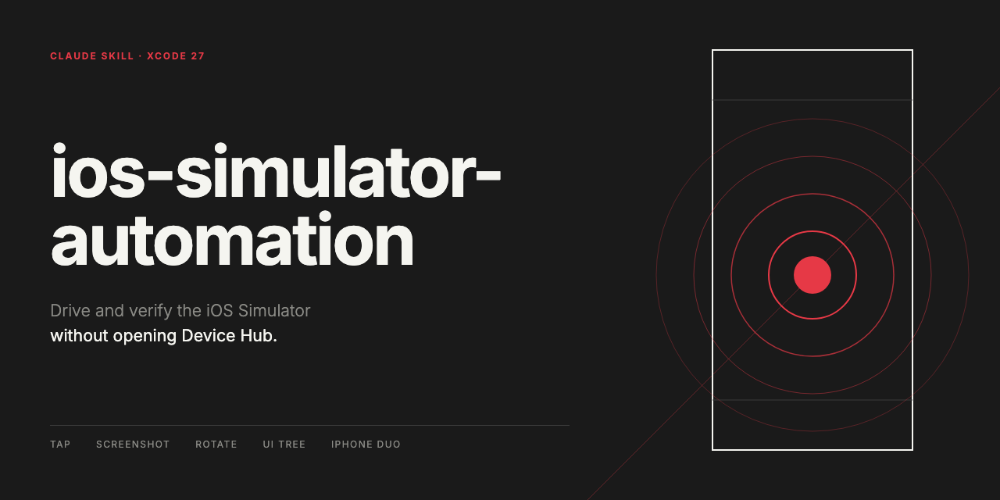

# ios-simulator-automation



**English** | [日本語](#日本語)

A Claude skill for driving and verifying the iOS Simulator from the command line and MCP.

Several tools can drive the simulator, and **among tools that nominally do the same thing, some work and some do not**. Worse, some of them return success while nothing actually happens. This skill sorts out which one to reach for.

At its center is the idea of **keeping track of why a tool was chosen**. If you cannot tell whether you are avoiding something because it is broken or because the other path is the proper one, you have no way to revisit the choice once the layer underneath is fixed. A guide that only lists the steps goes stale at that point.

The other axis is **not opening Device Hub**. Device Hub takes over the screen and stops your work. Everything this skill covers can be done without it.

## What you can do with it

With this skill installed, Claude can carry out the following **without opening Device Hub**:

| What you want to do | What it uses |
|---|---|
| Tap (portrait, landscape, iPhone Duo's inner display) | `tap` in Claude's simulator panel, or `axe tap -x -y` |
| Read element coordinates and labels | `axe describe-ui` |
| Type text and press keys | `axe type` / `axe key` |
| Trigger a keyboard shortcut (`keyboardShortcut`, with ⌘ or without a modifier) | `axe key-combo` / `axe key` |
| Send keys to a view's `onKeyPress` | `axe key` / `axe key-combo` |
| Take a screenshot | `screenshot` in Claude's simulator panel, or `xcrun simctl io <UDID> screenshot` |
| Rotate the device | `xcrun devicectl device orientation set` |
| Rotate, tap and dump the hierarchy in one call | Xcode MCP's `DeviceInteractionSynthesize` |
| Dark mode, text size, contrast | `xcrun simctl ui` |
| Set up a screen's state | Operate the UI with `axe tap` |
| Override the status bar | `xcrun simctl status_bar` |
| Change the width of a resizable window (iPhone only) | `xcrun devicectl device appResize start` / `set` |
| Fold, unfold or rotate iPhone Duo, read its screens and hinge | `axe hinge set` / `axe rotate` / `axe displays` |

And some paths **report success while nothing actually happens** — mobilebuildmcp's `tap` / `swipe` / `key_press` / `snapshot_ui`, which by default call the old AXe bundled with it. Pointing `MOBILEBUILDMCP_AXE_PATH` at the Homebrew AXe makes them work, both as an MCP server and from its command line. The skill names the path that does work, so you do not spend an hour on a tap that was never delivered.

## Supported versions

**Xcode 27.2 or later / iOS 27.2 or later simulators / AXe 2.1.1 or later (Homebrew).**

Older AXe releases report success for taps and key input without delivering them. Check with `axe --version`.

`Simulator.app` is gone, replaced by `Device Hub`, which **handles simulators and physical devices in a single window**. Along with that, `devicectl`, which used to be the CLI for physical devices, was extended to cover simulators. **This is why rotation and resizable windows, which `simctl` lacks, exist in `devicectl`.**

References: [Michael Tsai — Xcode 27's Device Hub](https://mjtsai.com/blog/2026/06/25/xcode-27s-device-hub/) / [Bitrise — WWDC 2026: Device Hub and what it means for CI/CD](https://bitrise.io/blog/post/wwdc-2026-device-hub-and-what-it-means-for-ci-cd)

## What the skill itself contains

In this order:

- **Rules to follow first** — do not open Device Hub, do not trust return values, put the value you read back into the report, take coordinates from `describe-ui`
- **Choosing a tool** — the table above, with why each one
- **Common recipes** — boot, read coordinates, tap, type, screenshot, rotate and set up state, as ready-to-run commands
- **Key input and shortcuts** — the key numbers to pass, what gets through (with ⌘, without a modifier, `onKeyPress`), and how `onKeyPress` can swallow shortcuts
- **Resizable windows** — how to start a session with `appResize`, change the size, and capture the resized screen; not available on iPad, and only while folded on iPhone Duo
- **iPhone Duo** — folding, half-folding, rotating and tapping with AXe alone, the inner and outer displays, taking screenshots of each, and what to do when the screen stops switching or the hinge or input gets quarantined
- **mobilebuildmcp** — why it reports success without doing anything by default, and how to point it at the Homebrew AXe
- **Coordinate pitfalls** — landscape coordinates, and apps that do not rotate
- **Background** — Device Hub and why `devicectl` now covers simulators

## Layout

```
SKILL.md
```

## Installation

Copy it into Claude's skills directory.

```bash
cp -R ios-simulator-automation-skill ~/.claude/skills/ios-simulator-automation
```

To use it in a single project:

```bash
cp -R ios-simulator-automation-skill <project>/.claude/skills/ios-simulator-automation
```

It comes into play when you want to check a screen in the simulator, taps are not landing, element coordinates cannot be read, you want to try key input or shortcuts, rotate the device, change the window width, UI automation is flaky, or you want to get by without opening Device Hub.

## Sources

**Everything here was measured.** None of it was copied out of documentation.

Measured on 2026-11-21 with Xcode 27.2, iOS 27.2 and AXe 2.1.1, on the iPhone 18 Pro, iPhone Duo and iPad Pro 11-inch (M5) simulators. **Device Hub was not running**: the simulators were booted with `xcrun simctl boot`. Each operation was confirmed by reading the screen back with `describe-ui` and by taking screenshots, not by return values.

## License

MIT

---

# 日本語

[English](#ios-simulator-automation) | **日本語**

iOS シミュレータをコマンドと MCP で操作・検証するための Claude スキルです。

シミュレータを動かす道具は複数あり、**同じことができる道具でも、動くものと動かないものが混ざっています**。しかも「成功」と返しておきながら実際には何も起きない、という種類の失敗があります。このスキルは、その中でどれを使うかを整理したものです。

中心にあるのは、**なぜその道具を選んだのかを区別して持っておく**という考え方です。壊れているから避けているのか、それが本来の道なのかが分からないと、下の層が直ったときに見直せません。手段を並べただけの手順書は、そこで古くなります。

もう一つの軸が **Device Hub を開かないこと**です。Device Hub は画面を占有して作業を止めます。このスキルで扱う操作は、すべて Device Hub を開かずにできます。

## できること

このスキルを入れると、Claude は次の操作を **Device Hub を開かずに**行えます。

| やりたいこと | 使うもの |
|---|---|
| タップ（縦向き・横向き・iPhone Duo の内側） | Claude のシミュレータパネルの `tap`、または `axe tap -x -y` |
| 要素の座標・ラベルを読む | `axe describe-ui` |
| 文字を打つ・キーを押す | `axe type` / `axe key` |
| キーボードショートカットを押す（⌘ 付き・修飾キーなしの `keyboardShortcut`） | `axe key-combo` / `axe key` |
| view の `onKeyPress` にキーを送る | `axe key` / `axe key-combo` |
| スクリーンショットを撮る | Claude のシミュレータパネルの `screenshot`、または `xcrun simctl io <UDID> screenshot` |
| 回転させる | `xcrun devicectl device orientation set` |
| 回転・タップ・階層をまとめて取る | Xcode MCP の `DeviceInteractionSynthesize` |
| ダークモード・文字サイズ・コントラスト | `xcrun simctl ui` |
| 画面の状態を作り込む | `axe tap` で UI を操作する |
| ステータスバーを上書きする | `xcrun simctl status_bar` |
| 可変ウインドウの幅を変える（iPhone だけ） | `xcrun devicectl device appResize start` / `set` |
| iPhone Duo の開閉・回転、画面とヒンジの読み取り | `axe hinge set` / `axe rotate` / `axe displays` |

それから、**「成功」と返すのに実際には効かない経路**があります。mobilebuildmcp の `tap` / `swipe` / `key_press` / `snapshot_ui` で、何も指定しないと同梱の古い AXe を呼ぶためです。`MOBILEBUILDMCP_AXE_PATH` で Homebrew 版の AXe を指すと、MCP でもコマンドでも効きます。スキルは効く経路を示します。届いていないタップの原因探しに時間を使わずに済みます。

## 対象バージョン

**Xcode 27.2 以降、iOS 27.2 以降のシミュレータ、AXe 2.1.1 以降（Homebrew 版）。**

これより古い AXe では、タップとキー入力が成功と返すのに効きません。`axe --version` で版を確かめてください。

`Simulator.app` が無くなり、`Device Hub` に置き換わりました。Device Hub は**シミュレータと実機を1つのウインドウで扱います**。それに合わせて、実機用の CLI だった `devicectl` がシミュレータも扱うようになりました。**`simctl` に無い回転と可変ウインドウが `devicectl` にあるのはこのためです。**

参考: [Michael Tsai — Xcode 27's Device Hub](https://mjtsai.com/blog/2026/06/25/xcode-27s-device-hub/) / [Bitrise — WWDC 2026: Device Hub and what it means for CI/CD](https://bitrise.io/blog/post/wwdc-2026-device-hub-and-what-it-means-for-ci-cd)

## スキル本文に書いてあること

次の順に並んでいます。

- **最初に守ること** — Device Hub を開かない、返り値を信用しない、読み出した値を報告に書く、座標は `describe-ui` から取る
- **道具の選び方** — 上の表に、なぜそれかを付けたもの
- **よく使う組み立て** — 起動・座標の取得・タップ・入力・撮影・回転・状態づくりを、そのまま使えるコマンドで
- **文字・キーの入力とショートカット** — 渡すキーの番号、届くもの（⌘ 付き・修飾キーなし・`onKeyPress`）、`onKeyPress` がショートカットを止める注意
- **可変ウインドウの幅** — `appResize` でセッションを始め、大きさを変え、リサイズした画面を撮る手順。iPad では使えず、iPhone Duo は閉じた状態だけ
- **iPhone Duo** — AXe だけでの開閉・半折り・回転・タップ、内側と外側の画面とそれぞれの撮り方、画面が切り替わらなくなったときやヒンジ・入力が止まったときの対処
- **mobilebuildmcp** — 何も指定しないと成功と返して効かない理由と、Homebrew 版の AXe に向ける方法
- **座標の落とし穴** — 横向きの座標、横に回らないアプリ
- **背景** — Device Hub と、`devicectl` がシミュレータを扱うようになった理由

## 構成

```
SKILL.md
```

## 導入

Claude のスキルディレクトリへコピーします。

```bash
cp -R ios-simulator-automation-skill ~/.claude/skills/ios-simulator-automation
```

プロジェクト単位で使う場合は次のようにします。

```bash
cp -R ios-simulator-automation-skill <project>/.claude/skills/ios-simulator-automation
```

シミュレータで画面を確認したい、タップが効かない、要素の座標が取れない、キー入力やショートカットを試したい、回転させたい、ウインドウの幅を変えたい、UI 自動操作が不安定、Device Hub を開かずに済ませたい、といった場面で起動します。

## 出典

**すべて実測です。** ドキュメントからの引き写しではありません。

2026-11-21 に、Xcode 27.2・iOS 27.2・AXe 2.1.1 で、iPhone 18 Pro・iPhone Duo・iPad Pro 11-inch (M5) のシミュレータを使って確かめました。**Device Hub は起動せず**、シミュレータは `xcrun simctl boot` で起動しています。どの操作も返り値ではなく、`describe-ui` で読み直した値と撮影で確かめています。

## ライセンス

MIT
